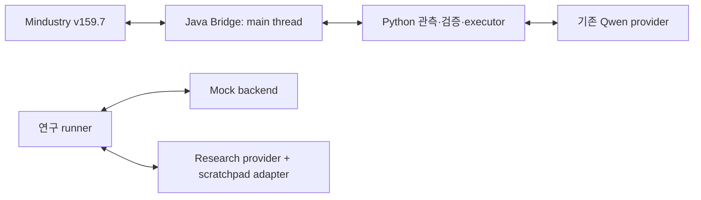
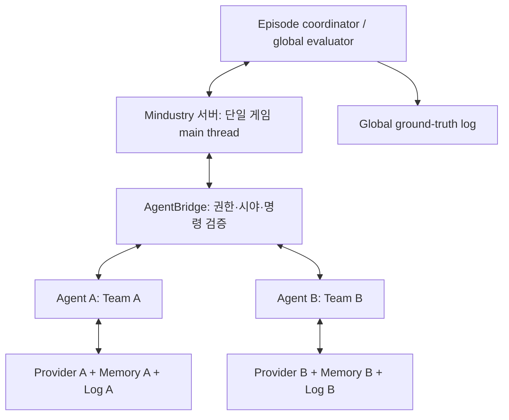
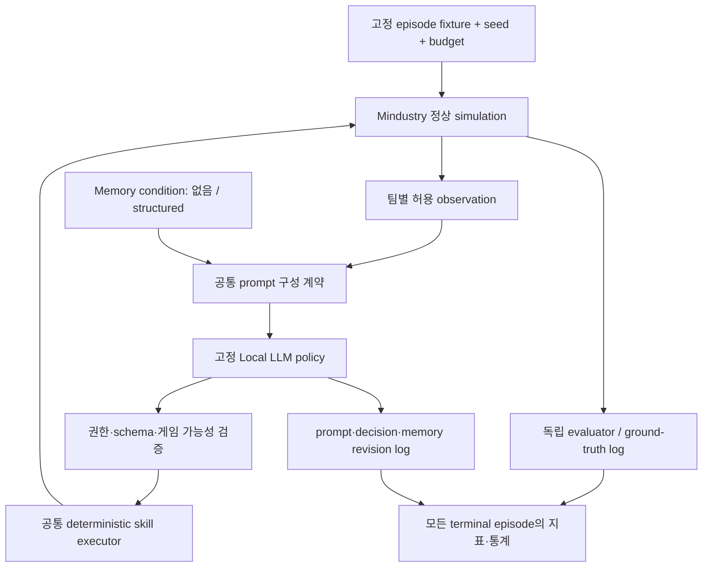

# Mindustry AgentBridge 독립 기술·연구설계 감사

기준일: 2026-09-29, Asia/Seoul. 감사 대상: `stage4-agent`, `596ad51`.

이번 작업은 소스·Git·문서·기존 로그·참조 API 검사, 기존 테스트, 작은 mock 진단, 1차 자료 조사로 한정했다. 게임을 재실행하거나 모델을 호출하지 않았고, gameplay 코드·참조 소스·설정·checkpoint를 변경하지 않았다. 아래 설계와 roadmap은 **제안이며 미구현**이다.

## 1. Executive Summary

**기존 구현은 정상 게임 메커니즘으로 LLM 지시를 실행할 수 있는 환경 기반을 입증했다. 하지만 아직 Local LLM의 장기 기억 효과를 평가하는 연구 시스템을 입증하지는 못했다.**

Mono 채굴, Poly 이동, 정상 BuildPlan 건설, drill→conveyor→core의 특정 물류 경로는 과거 headless 실행 로그와 사용자의 GUI 확인으로 뒷받침된다. 기존의 단순 conveyor 건설 검증과 이후 functional logistics 검증은 서로 다른 실행이다. 이번 감사에서는 로그와 파일을 재확인했으며 GUI를 다시 관찰한 것은 아니다.

핵심 문제는 물류 성공 자체가 아니라 **그 성공에 LLM의 기억이 필요한가**이다. 현재 Python이 후보 선택, 전체 경로, 자원 임계값, 연속 건설, 부족 자원 보충, 유량 검증과 상당한 복구를 담당한다. GUI 물류 실행의 360초 중 LLM 판단은 3회였다. `phase`, `resourcesSufficient`, 완성된 계획 요약이 다음 답을 거의 제공한다. 이 benchmark에서 scratchpad 효과가 작아도 기억 방법이 무용하다고 결론 낼 수 없다.

실험 프레임워크는 mock 수준이다. 실제 게임 실행 경로와 연결되지 않았고, context reset은 현재 provider에서 실질적인 대화 이력 제거를 발생시키지 않는다. 성공·실패 집계에도 반례가 발견됐다. 따라서 다음 목표는 새 게임 기능이나 전투가 아니라 **기억 연구에 유효한 의사결정·관측·평가 계약을 확정하고 검증하는 것**이다.

## 2. 최종 판정

**CONDITIONAL GO.** 기존 Bridge, 정상 executor, 공간 계산, 관측·완료 판정은 유지한다. 전면 재작성할 근거는 없다. 다만 현재 상태에서 scratchpad 비교 본실험과 대전 성능 주장은 **HOLD**다.

| 판단 | 신뢰도 | 근거와 한계 |
|---|---|---|
| 기존 정상 물류 실행 기반은 재사용 가능 | 높음 | 소스, 과거 두 종류 runtime 로그, 사용자 GUI 보고가 일치 |
| 현재 연구 설계에는 중요한 교란이 있음 | 높음 | 상태기계·prompt·mock backend·reset 구현을 직접 확인 |
| 국소적인 경계 조정으로 연구 전환 가능 | 중상 | 계층 분리가 존재하지만 live 통합 검증은 아직 없음 |
| Human/Agent 대전 확장 가능 | 중간 | v159.7 명령·시야·소유권 API의 정적 근거; 실제 대전 미실행 |
| 현재 Mac에서 두 Local LLM agent가 충분히 빠름 | 판단 보류 | 하드웨어만 확인; 추론 지연 미측정 |

신뢰도는 통계적 확률이 아니라 증거 강도에 대한 감사자의 판단이다. 조건은 연구용 책임 경계, 지표 정확성, 실제 episode 재현성 확보이며, 대전에는 별도로 team isolation이 필요하다.

## 3. 현재 프로젝트 실제 진행률

범위가 확정되지 않은 전체 프로젝트에 임의의 완료 백분율을 붙이지 않는다.

| 영역 | 실제 단계 | 분류 |
|---|---|---|
| Environment | v159.7 전용 서버·localhost HTTP·정상 게임 조작, 특정 fixture 검증 | VERIFIED — 과거 runtime |
| Agent | 단일 agent의 채굴·건설·관측 루프와 특정 물류 과업 | VERIFIED — 해당 fixture 한정 |
| LLM integration | Qwen cloud/OpenCode 지시가 실제 게임 실행으로 이어짐 | VERIFIED — 과거 runtime |
| Scratchpad | bounded schema·원자적 저장·reload·조건 adapter와 단위 테스트 | PARTIALLY VERIFIED — 저장 기능, 효과 미검증 |
| Experiment framework | metadata/events/metrics/summary를 만드는 mock runner | PARTIALLY VERIFIED — live 연결 및 실패 처리 불완전 |
| Local LLM | Ollama 설치, 응답하는 서비스의 모델 목록은 비어 있음 | NOT VERIFIED — 게임 추론 미실행 |
| Multi-Agent | agent identity·팀별 세션·동시 평가 미구현 | NOT VERIFIED |
| Combat | 참조 게임 API는 존재; Bridge 전투 명령 없음 | NOT VERIFIED |
| Evaluation | 과거 functional 성공 증거 있음; 인과적 memory 비교 없음 | PARTIALLY VERIFIED |

### Git 및 현재 실행 환경

- 감사 시작 작업 트리는 clean, untracked 없음. 현재 branch `stage4-agent`, HEAD `596ad51`.
- 실제 remote 조회에서 `origin/stage4-agent`는 `82b3ce7aac23cfb5e145f30162e20416ffd26da5`. 로컬은 **ahead 9 / behind 0**이며 최근 연구 및 물류 checkpoint는 해당 remote branch에 백업되지 않았다.
- 로컬 `master`와 cached `origin/master`는 `fdeb005`. 로컬 master는 stage4-agent의 조상이며 로컬 비교는 `0 / 16`이다. **실제 remote master는 `6bb236db40c4ee4a067c757ef7bf73df6a8b060b`로 달랐다.** fetch하지 않았으므로 실제 remote master와의 ancestry는 미확정이다. cached ref만으로 “remote master도 옛 movement 상태”라고 단정하면 안 된다.
- 다른 두 worktree는 Stage 10 checkpoint를 가리키며 수정하지 않았다. push·merge·rebase·branch 변경은 하지 않았다.
- `6567`/`8765` LISTEN이 없는 상태를 확인했다. 이번 감사에서 서버·agent를 시작하지 않았다.
- `build.gradle`은 Mindustry `v159.7`, Java source/target 17로 고정돼 있다. 참조 checkout도 v159.7이며 clean이다. 이번 감사에서 Java 재컴파일은 하지 않았다.
- 기본 `python3`는 3.9.6이며 테스트 import 실패 4건이 발생했다. `/opt/anaconda3/bin/python3` 3.13.5에서는 **38/38 통과**했다. 프로젝트의 Python 최소 버전·실행 환경 명시가 필요하다.

| 주요 checkpoint | 의미 |
|---|---|
| `21f0d92` | Stage 10 정상 건설 및 move 이후 builder command 복원 |
| `8a4ac47`, `32681f6` | 지속 autonomous control 구현·실행 증거 |
| `a5dd369`, `a226781` | functional logistics 및 deterministic fixture |
| `68514d0` | 물류 GUI 검증 기록 |
| `bf670b1` | benchmark manifest·provider 경계 |
| `f717142` | bounded scratchpad |
| `596ad51` | mock experiment runner·metrics |

## 4. VERIFIED / PARTIALLY VERIFIED / NOT VERIFIED

**표의 headless·GUI는 과거 증거다. 이번 감사에서 새 runtime 검증을 했다는 뜻이 아니다.** Unit은 Python 단위 테스트이며 Java 게임 통합 테스트가 아니다. `부분`은 관련 로직 테스트가 있다는 뜻이며 전체 기능 보증이 아니다.

증거 약어:

- C: `agent/autonomous_llm_agent.py`, `src/agentbridge/{StateCapture,DemoObservation,ActionHandler,StateHttpServer,ActionHttpHandler}.java`.
- L: `agent/{logistics_agent,logistics_planner}.py`, `src/agentbridge/LogisticsObservation.java`.
- R: `research/{provider,condition,scratchpad,benchmark,runner,metrics}.py`, `experiment.py`.
- T: `tests/test_autonomous_llm_agent.py`, `test_logistics_planner.py`, `test_scratchpad.py`, `test_research_provider.py`, `test_experiment_runner.py`.
- H1/G1: control vertical slice headless/GUI 로그. H2/G2: functional logistics headless/GUI 로그. 정확한 경로와 hash는 아래 기록한다.

| 항목 | 구현·분류 | Unit | Headless | GUI | commit / 소스 / log | 남은 한계 |
|---|---|---|---|---|---|---|
| A Observation | 있음 / VERIFIED | 부분 | H1,H2 | G1,G2 | `8a4ac47`,`a5dd369` / C,L | defaultTeam·공개 시야 범위만; fog 격리 없음 |
| B Move | 있음 / VERIFIED | 부분 | H1,H2 | G1,G2 | `21f0d92`,`8a4ac47` / C,L | 군집·적대 팀 미검증 |
| C Mine | 있음 / VERIFIED | 부분 | H1,H2 | G1,G2 | `802e2ca`,`8a4ac47` / C,L | copper/lead·Mono fixture |
| D Build | 있음 / VERIFIED | 부분 | H1,H2 | G1,G2 | `21f0d92`,`a5dd369` / C,L | 정상 BuildPlan; 범용 건물 미검증 |
| E Continuous runtime | 있음 / VERIFIED | 부분 | 300/360초 | 300/360초 | `32681f6`,`a5dd369` / C,L / H1–G2 | 장시간 관측 ≠ 다수 전략 판단 |
| F LLM decision | 있음 / VERIFIED | mock | H1,H2 | G1,G2 | `8a4ac47`,`a5dd369` / C,L | cloud Qwen; local 아님 |
| G LLM→action | 있음 / VERIFIED | 부분 | H1,H2 | G1,G2 | 같은 commit / C,L | 물류 intent 이후 다수 행동은 Python |
| H Completion | 있음 / VERIFIED(게임), PARTIAL(실험 집계) | 있음 | H1,H2 | G1,G2 | C,L,R / `596ad51` 포함 | HTTP 접수와 실제 완공 구분; runner 성공 오류 별도 |
| I Replanning | 있음 / PARTIALLY VERIFIED | 부분 | H1,H2 | G1,G2 | C,L | 물류 MAINTAIN은 후속 1회 기록, 지속 재전략화 아님 |
| J Fixture/reset | save·절차 있음 / PARTIALLY VERIFIED | mock | 수동 준비 H2 | 수동 준비 G2 | `a226781` / LOGISTICS_DEMO, manifest | 자동 live episode reset 없음 |
| K Drill placement | 있음 / VERIFIED | 있음 | H2 | G2 | `a5dd369` / L | 고정 범위 copper 후보 |
| L Conveyor routing | 있음 / VERIFIED | 있음 | H2 | G2 | `a5dd369` / L | 단일 drill/core; 일반 network 아님 |
| M Resource flow | 있음 / VERIFIED | 있음 | H2 | G2 | `a5dd369`,`68514d0` / L | 통제 fixture의 복합 증거; 범용 item 출처 추적 아님 |
| N GUI verification | 사람 확인 / VERIFIED | 해당 없음 | 해당 없음 | G1,G2 | `68514d0` / PROGRESS | 사용자 보고; 이번 재관찰·영상 분석 아님 |
| O Logging | 있음 / PARTIALLY VERIFIED | 있음 | H1,H2 | G1,G2 | C,L,R | prompt·memory 각 버전·모델 digest 부족 |
| P Metrics | 있음 / PARTIALLY VERIFIED + RISK | 있음 | 연구 지표 없음 | 없음 | `596ad51` / R,T | 성공·goal loss·효율·token coverage 문제 |
| Q Provider abstraction | 있음 / PARTIALLY VERIFIED | 있음 | 기존 provider만 | 기존 provider만 | `bf670b1` / R | 새 adapter의 live 경로 미연결 |
| R Scratchpad | 있음 / PARTIALLY VERIFIED | 있음 | 없음 | 없음 | `f717142` / R,T | 기억 효과·live 사용 미검증 |
| S Local LLM | 없음 / NOT VERIFIED | 없음 | 없음 | 없음 | provider 확장 가능 | 모델 미설치·성능 미측정 |
| T Experiment runner | mock 있음 / PARTIALLY VERIFIED | 있음 | 실제 게임 없음 | 없음 | `596ad51` / R,T | `--provider qwen`도 backend는 mock |
| U Context reset | hook 있음 / PARTIALLY VERIFIED | mock count/reload | 없음 | 없음 | `f717142` / R | 현재 OpenCode reset은 no-op |
| V Multi-agent | 없음 / NOT VERIFIED + BLOCKER | 없음 | 없음 | 없음 | Bridge 단일 팀 가정 | identity·권한·공정성 먼저 필요 |
| W Combat | 없음 / NOT VERIFIED | 없음 | 없음 | 없음 | v159.7 API 정적 조사만 | 이번 보고서는 설계만 |

### 기존 실행 증거의 범위

모든 로그는 저장소 아래 `build/demo-runs/`에 있으며 Git ignored다. 파일 존재와 내용을 이번 감사에서 확인했다.

| 증거 | 파일 | 주요 내용 | SHA-256 |
|---|---|---|---|
| H1 | `vertical-slice-20260908-mining-build.jsonl` | 300.669초, 관측299, 판단8, action4, mine milestone1, build3, 검증 거절1 | `9963d1b0bbec7df6debe4ed70e8faa8d925b1a71c3d16d6da04a1929bdba790d` |
| G1 | `gui-vertical-slice-20260909.jsonl` | 300.105초, 관측299, 판단8, action4, build3. **functional logistics 아님** | `79baa0d104f867bd73e58e79d2f4e71b73144db2013b1ab795203f64ab33d834` |
| H2 | `logistics-headless-20260909-verified.jsonl` | 360.649초, 관측358, 판단3, action15, block12, flow1, MAINTAIN | `095592cf09b0f107c9b866dc775f0fac7c18f5139948c4246545a28f0d7fcb86` |
| G2 | `logistics-gui-20260909.jsonl` | 360.249초, 관측356, 판단3, action9, block6, flow1, MAINTAIN | `754c47e72a2ed3323821a2d9281f0cf374524c7416705874169c2e10e60b8577` |

G2는 drill `(151,53)`, conveyors `(153..157,53)`, core footprint `(158..160,51..53)`의 연결을 기록한다. 사용자는 실제 item 이동·core 유입을 확인했다. PROGRESS의 최종 copper 90/누적 수령28은 당시 종료 후 독립 상태 관측 기록이며 이번 재측정은 아니다. H2와 G2의 block 수가 다르므로 같은 좌표 경로를 실행했다고 표현하지 않는다.

save `/Users/andrew/capstone/MindustryServer/config/saves/autonomous-logistics-base.msav`의 hash는 manifest와 같은 `1a70fe390341fa4fed62b189053838a750762266d01f31606a159dfc24eabc4f`였다. 현재 build 및 배포 JAR도 서로 같으며 SHA-256은 `60c79393e5cddf855e5baf570537198cf21387c119f14f479ae94769ffbe5def`다. hash 일치는 현재 파일 동일성 증거이며 새 runtime 성공 증거는 아니다.

## 5. 기존 architecture 평가

위에서 두 실행 경로는 **아직 live 연구 경로로 합쳐져 있지 않다**. `ResearchDecisionAdapter`가 `decide(summary)` 모양을 맞춘 것은 유용하지만, `agent/logistics_agent.py`의 실제 entrypoint는 기존 provider를 만든다. `research/runner.py:174`는 항상 `MockLogisticsBackend`를 만든다. 같은 planner/runtime 파일명을 metadata에 써도 실행 동등성이 성립하지 않는다.

Bridge의 main-thread 접근, JSON 경계, Python의 비동기 추론·주기 관측, 실제 타일 완공 판정은 유지할 부분이다. 반면 benchmark oracle, agent policy, fixture 제어와 평가 ground truth는 더 명확하게 분리해야 한다. evaluator는 모든 상태를 알아도 되지만 그 정보가 agent observation이나 자동 복구 정책에 새어 나오면 연구 조건을 깨뜨린다.

## 6. LLM vs Python responsibility audit

근거: [물류 runtime](/Users/andrew/capstone/MindustryAgentBridge/agent/logistics_agent.py:149), [planner](/Users/andrew/capstone/MindustryAgentBridge/agent/logistics_planner.py), [연구 runner](/Users/andrew/capstone/MindustryAgentBridge/research/runner.py:19).

| 판단/행동 | 현재 실제 담당 | 연구 관점 판정 | 권장 경계 |
|---|---|---|---|
| 타일 적합성·footprint·비용·회전·BFS | Java/Python | 적절 | 유지, 모든 조건 공유 |
| drill/route 후보 중 최종 선택 | Python `choose_plan` | 전략적 선호도 포함 | 후보·비용을 제공하고 LLM이 의미 있는 trade-off 선택; 고정 skill이면 범위를 명시 |
| copper 부족 판정 | Python 수치 비교 | 적절한 사실 계산 | 사실 제공은 허용 |
| 부족하면 채굴해야 한다는 정책 | prompt와 상태기계, 일부 LLM intent | 과도한 선결정 | LLM 선택, executor는 가능성·권한만 검증 |
| 최초 bootstrap intent | LLM | 실제 결정이나 선택 폭 좁음 | 유지하되 다른 유효 선택과 결과 구분 |
| logistics 시작 | LLM | macro skill 호출 | 허용하되 장기 계획 능력으로 과장하지 않음 |
| drill+전체 conveyor 연속 완성 | Python `_build` | 합법적인 skill이나 현재 연구를 대부분 대행 | 기계적 구간 자동화 유지, 전략적 분기에서 반환 |
| 건설 중 copper 부족 시 다시 mining | Python `_build` | 명시적 전략 자동화 | 실패/부족 사실을 반환하고 agent가 복구 선택 |
| Mono lead 전환·Poly 주차 | Python | 유량 출처 통제를 위한 시험 절차 | fixture/evaluator 조치로 명시·양 조건 동일; LLM 전략으로 세지 않음 |
| 건설/flow 완료 판정 | Python | 적절 | 독립 evaluator와 agent 피드백 분리 |
| 오류 후 PLAN 복귀·재경로 | Python | 복구 성과 귀속 위험 | 실행 재시도와 전략 변경을 구분해 기록 |
| 완료 뒤 후속 판단 | LLM 1회, Python 기록 | 제한된 재판단만 입증 | 후속 판단에 따라 실제 정책이 달라지는 시험 필요 |

`_summary()`는 phase·자원 충분 여부·선택된 계획·완공 여부를 준다. `_accept_decision()`은 충분한 자원이 있는데 bootstrap을 선택하면 거절한다. 안전 검증을 넘어 특정 정책을 정답으로 강제하는 부분이다. mock에서는 bootstrap 단계의 `wait`도 goal loss로 분류한다. 이것은 기억 상실의 측정이 아니다.

`MAINTAIN`에서는 어떤 후속 decision도 완료 상태 유지로 기록하고 `maintenance_decided=True`로 설정한다. 이후 추가 LLM 호출이 없다. 따라서 기존 기록의 “완료 후 후속 판단”은 유효하지만, **계속되는 전략적 재계획·환경 변화 대응을 입증했다는 해석은 수정해야 한다.**

현재 deterministic planner 위험은 **높음**이다. deterministic pathfinding 자체가 문제라서가 아니라, 기억으로 달라질 주요 선택이 이미 Python에 들어 있기 때문이다. LLM에게 conveyor 모든 좌표를 직접 계산시키는 방식도 해결책이 아니다. 이는 기억 실험을 공간 오류·JSON 오류 시험으로 바꾼다.

## 7. 기존 구현에서 잘된 점

1. HTTP 성공과 실제 타일 완공을 구분하고 자원 소비·위치·queue·flow 증거를 모았다.
2. 정상 `InputHandler`, command/stance, `BuildPlan`을 사용한다. 건설을 즉시 배치로 대체하지 않았다.
3. finite resources·기본 건설 속도로 move→build 문제를 재현하고 작게 수정했다.
4. GUI에서 확인되지 않은 첫 물류 주장을 정정하고, 이후 연결된 물류 검증을 별도 기록했다.
5. 기존 runtime-tested agent를 보존했고 새 연구 코드를 별도 디렉터리에 추가했다.
6. strict JSON, subprocess 격리, 비동기 관측, stale decision 거절 등 좋은 기반이 있다.
7. bounded scratchpad, 원자적 파일 교체, episode별 output, benchmark fingerprint는 연구 도구로 발전시킬 수 있다.

이는 연구 결과의 입증이 아니라 **재사용할 공학적 자산**에 대한 평가다.

## 8. 현재 위험요소 / 기술부채

### 연구와 실험 정확성

| 우선도·분류 | 발견 | 근거 / 영향 |
|---|---|---|
| P0 BLOCKER — 기억 효과 결론 | 현재 관측과 상태기계만으로 다음 행동이 거의 결정됨 | 360초에 판단3회; memory ablation 구별 능력 부족 |
| P0 BLOCKER — live 연구 | runner가 mock 고정; 실제 runtime과 executor도 다름 | mock은 mining27, drill+5 conveyor, flow를 즉시 합성. live의 lead 전환·주차 등도 누락 |
| P0 RISK — 성공 오판 | flow completion 뒤 후속 판단 실패해도 `task_success=true` | frozen 성공 기준에 후속 재판단 포함. 이번 반례에서 goal_loss1인데 성공 |
| P0 BLOCKER — reset 주장 | OpenCode `reset_context()`는 no-op | 매 호출 새 stateless 요청. reset 횟수는 기억 소실의 증거가 아님 |
| P1 RISK — 실패 누락 | provider `OSError` 시 cleanup은 되지만 metrics/summary 생성되지 않음 | 실패 episode가 분석에서 빠질 수 있음 |
| P1 RISK — timeout | episode budget을 blocking provider에 전달하지 않음 | 1초 budget/1.1초 mock 호출에서 1.105초 소요. 실제 provider 제한은 별도120초 |
| P1 RISK — metric 의미 | resource efficiency는 같은 변수를 분자·분모에 사용 | 성공하면 구조적으로1; 절약 능력 측정 불가 |
| P1 RISK — redundancy/goal loss/recovery | 직전 action+관측 버전만 비교; 허용 순서 위반을 goal loss로 명명 | 반복 판단·전략 일관성·실패 복구를 측정하지 못함 |
| P1 RISK — token/latency | 유효 decision만 집계, missing usage coverage 없음 | 일부 사용량만 있어도 전체 합계처럼 보임; 오류 호출 비용 누락 |
| P1 RISK — memory 감사 가능성 | update 로그에 revision/bytes만 기록, 최종 파일 overwrite | 어떤 기억이 어떤 판단을 바꿨는지 재구성 불가 |
| P1 RISK — benchmark 계약 | manifest의 `/units`, `/buildings`, `/tasks/{task_id}`는 구현에 없음 | 실제 등록 endpoint는 `/state`, `/action`; live fixture 검증 필드도 불일치 |
| P2 RISK — 고정성 | frozen dataclass 내부 mapping은 변경 가능; seed는 mock에 저장만 됨 | fingerprint·seed 기록을 실행 재현성 보증으로 해석하면 안 됨 |

**진단 증거:** [probes.json](/Users/andrew/capstone/MindustryAgentBridge/build/audit-20260929/probes.json). 기존 API에 scripted response/예외를 넣은 작은 mock 진단이며 새 게임 실험 캠페인이 아니다. post-completion `reconsider` 실패에도 성공으로 집계되고, missing usage가 있는 두 decision은 알려진 값10/2만 합산됐다. 이 반례들은 현재 38개 테스트 통과와 동시에 성립한다.

기본 Python3.9에서는 `agent/autonomous_llm_agent.py:295`의 `int | None` 평가로 import가 실패한다. [3.9 결과](/Users/andrew/capstone/MindustryAgentBridge/build/audit-20260929/tests.txt), [3.13 결과](/Users/andrew/capstone/MindustryAgentBridge/build/audit-20260929/tests-python313.txt)를 보존했다. scratchpad의 “재시작” 테스트는 같은 프로세스 안에서 adapter를 새로 만드는 시험이며 실제 프로세스 종료/재기동 내구성 시험은 아니다.

### Bridge·대전 경계

- **BLOCKER — dual-team authorization:** `StateCapture.java:36`은 첫 player가 아니라 `rules.defaultTeam`을 사용한다. 반면 `ActionHandler.java:206`은 요청받은 unit의 팀에 속한 첫 Player를 찾아 실행한다. caller identity에 팀이 묶여 있지 않으므로 상대 팀 Player가 존재하면 그 팀 unit ID를 요청하는 것도 막지 못한다. 같은 팀 확인이 있어도 caller 권한 검증이 아니다.
- **BLOCKER — hidden information:** demo tile query와 logistics scan은 ground truth 타일을 읽고 팀별 fog를 적용하지 않는다. bounded radius는 정보량 제한이지 공정한 시야 제한이 아니다.
- **RISK — episode race:** main thread에서 실행한다는 사실만으로 reset과 queued action의 논리적 순서가 보장되지 않는다. HTTP의 5초 응답 timeout 뒤 예약된 action이 실행될 수 있으며, world/episode ID·만료·중복 방지가 Bridge 경계에 없다.
- **RISK — 입력 계약:** Java action parsing은 완전한 schema 검증기가 아니다. 정규식/문자열 기반 숫자 해석, body 크기·finite 좌표·명령 whitelist 검증을 연구용 API 계약으로 명확히 해야 한다. localhost를 유지하되 여러 agent의 실수도 격리해야 한다.
- **PARTIALLY VERIFIED — flow attribution:** 현재 drill 활동+conveyor item+core 증가+Mono lead 전환은 해당 fixture에서 강한 증거다. 여러 copper source가 공존하는 일반 상황의 item별 출처 추적이나 지속 topology 감시는 아니다.

### 저장소·재현성

| 항목 | 결과 |
|---|---|
| Mindustry pin | VERIFIED: v159.7. 다시 pin할 작업은 불필요 |
| README | RISK: upstream template 내용과 latest 설명이 남아 실제 프로젝트를 설명하지 않음 |
| remote backup | RISK: stage4-agent의 최신9 commits는 remote branch에 없음. push는 별도 승인 필요 |
| master 관계 | 로컬은 불필요하게 갈라진 상태 아님. 실제 remote master ancestry는 미확정 |
| secrets | 확인한 reachable Git blob133개에서 주요 private-key/token 패턴0건. 완전한 비밀정보 부재 보증은 아님 |
| CI | Java JAR 중심. Python38 tests 실행 없음. artifact 이름과 실제 산출물 경로도 재현 환경에서 확인 필요 |
| save/log | hash는 문서화됐으나 save는 저장소 밖 절대 경로, runtime logs는 ignored. fresh clone만으로 재현 불가 |
| fixture 버전관리 | 소형 manifest+생성/복원 절차+hash 검증된 별도 artifact가 적합. 대형 모든 로그를 Git에 넣을 필요 없음 |
| model config | 이름은 있으나 digest/provider runtime 버전·temperature·top-p·token limit·thinking 설정의 실행 고정 부족 |
| seed | metadata seed와 게임 RNG·모델 seed의 실제 적용을 구분해야 함 |

## 9. 인터넷 조사 결과

2026-09-29에 논문·공식 repository·기관 문서 중심으로 조사했다. 외부 시스템을 설치하거나 성능을 재현하지 않았다. 아래 `미확인`은 불가능하다는 뜻이 아니라 해당 자료에서 이 감사가 확인하지 못했다는 뜻이다. 환경 라이브러리와 학습된 agent를 같은 종류의 완성 제품으로 비교하지 않는다.

### 프로젝트별 관측·행동·기억·평가

| 사례 | 관측 / action / 책임 분리 | 기억·deterministic 요소 | Human·대전·multi-agent | 평가·반복 / 우리에게 주는 시사점 |
|---|---|---|---|---|
| Voyager, Minecraft | 구조화된 게임 피드백, LLM이 실행 코드를 생성·수정, curriculum이 목표 제안 | 실행 가능한 skill library와 검색; Mineflayer 기반 저수준 기능 사용 | 주 연구는 단일 lifelong agent; 통제된 PvP 평가 미확인 | 탐색·아이템·과업/전이 성과. 자동 skill도 허용되지만 새 과업 선택이 agent에게 남음. [공식 프로젝트](https://voyager.minedojo.org/), [repo](https://github.com/MineDojo/Voyager) |
| Mineflayer + pathfinder, Minecraft | 블록·entity·inventory API와 move/dig/attack 등의 JS interface | pathfinding을 별도 deterministic plugin으로 제공. memory·LLM은 사용자가 설계 | 서버에 bot·사람이 공존할 기반; 연결 가능성과 공정한 PvP 연구는 별개 | 자체 논문 benchmark나 memory evaluator는 아님. 우리 Bridge와 비교할 기반 계층. [Mineflayer](https://github.com/PrismarineJS/mineflayer), [pathfinder](https://github.com/PrismarineJS/mineflayer-pathfinder) |
| MineDojo, Minecraft | RGB와 inventory·voxel·life/location 등 구조화된 관측, simulator action space | 환경/과업 suite이며 단일 memory agent가 아님 | 모든 task가 PvP/multi-agent라고 볼 근거 없음 | programmatic task 자동 평가, creative task 구분. 환경 oracle과 agent 설계 분리를 참고. [관측](https://docs.minedojo.org/sections/core_api/obs_space.html), [과업 API](https://docs.minedojo.org/sections/core_api/sim.html), [행동](https://docs.minedojo.org/sections/core_api/action_space.html) |
| AlphaStar, StarCraft II | 제한된 게임 인터페이스·카메라/행동 속도 아래 policy가 명령 선택 | RL·모방학습·league; recurrent policy의 내부 상태, 구조화 scratchpad 실험 아님. 이동 실행은 엔진 | 인간 상대·agent league 있음 | 대전 성능·리그 평가. 관측/명령 속도 공정성은 참고하되 학습 비용·목적은 다름. [DeepMind 최종 연구 설명](https://deepmind.google/blog/alphastar-grandmaster-level-in-starcraft-ii-using-multi-agent-reinforcement-learning/) |
| OpenAI Five, Dota 2 | 게임 API 상태, 각 hero 정책의 게임 명령, 대규모 self-play RL | LSTM 상태; 저수준 엔진 동작 활용. 외부 scratchpad 비교 아님 | 5인 팀 협동·self-play·인간 상대 | 승률과 대전. 구조화 API를 쓴다는 사실 자체는 연구 결함이 아니나 해당 학습 규모는 캡스톤 비교 대상 아님. [공식 설명](https://openai.com/index/openai-five/), [논문](https://cdn.openai.com/dota-2.pdf) |
| PettingZoo | agent별 observation/action/reward/termination을 정하는 multi-agent API | 정책·기억·pathfinding은 환경/사용자 책임 | multi-agent용; 인간 조작·PvP는 개별 환경에 의존 | Parallel API는 동시 action 묶음과 seed reset 계약 제공. 라이브러리 도입보다 명시적 episode 의미론을 참고. [공식 Parallel API](https://pettingzoo.farama.org/api/parallel/) |
| Melting Pot | 다중 agent 사회적 환경/substrate, focal/background policy 평가 | memory는 policy 책임, 고정 환경과 역할 조합 제공 | 여러 agent 상호작용이 중심; Mindustry식 직접 unit possession과는 다름 | population 조합과 episode별 결과로 일반화 평가. 고정 상대 pool과 역할 교대를 참고. [공식 repo](https://github.com/google-deepmind/meltingpot), [평가 구현](https://github.com/google-deepmind/meltingpot/blob/main/meltingpot/utils/evaluation/evaluation.py) |
| BALROG | 여러 게임의 text/visual 관측과 환경별 action으로 LLM 평가 | 환경 adapter와 prompting을 통제; 모든 게임에 공통 pathfinder가 있는 것은 아님 | 주로 단일 agent benchmark; PvP가 핵심 아님 | 게임별 progress/score를 정규화해 비교. 성공뿐 아니라 진행도와 harness 통제가 필요. [논문](https://arxiv.org/abs/2411.13543), [공식 repo](https://github.com/balrog-ai/BALROG) |
| MINDcraft / MineCollab | Minecraft 캐릭터, LLM이 고수준 행동·협업 소통, Mineflayer 기능 | bot별 구성과 기반 skill, local provider 지원; 협업 통신 자체가 변수 | 복수 bot·사람 공존 기반; 논문은 협업, PvP 검증으로 대신할 수 없음 | 협업 과업과 통신 방식 비교. agent 수 증가가 자동 성능 향상을 뜻하지 않음. [논문](https://arxiv.org/abs/2504.17950), [공식 repo](https://github.com/mindcraft-bots/mindcraft) |
| VideoGameBench, 2026 개정 | raw visual input·게임 제어, realtime VLM; 최신 v3 abstract는10게임 | 게임 특화 정보 추상화를 줄인 설정; 별도 Lite는 추론 중 게임 정지 | human-designed games이지만 공정 Human-v-Agent가 핵심 주장인 것은 아님 | 진행률과 realtime/Lite 비교. 추론 지연과 판단 능력을 분리해야 한다는 근거. [논문 v3](https://arxiv.org/abs/2505.18134v3) |
| AgenticSTS, 2026 preprint | Slay the Spire 2; 매 결정 fresh message에 typed retrieval로 bounded context 구성 | memory/skill 계층별 ablation, raw 누적 transcript 제외 | 장기 단일 agent, 대전 중심 아님 | prompt·trajectory·고정 memory snapshot 공개. 작은 ablation 차이를 통계적 확정으로 주장하지 않음. 우리 연구와 매우 직접적인 방법론 비교. [논문](https://arxiv.org/abs/2607.02255), [공식 repo](https://github.com/AlayaLab/AgenticSTS) |
| FM-Bench, 2026 preprint | 축구 구단 경영,26 tools·수백 decision stop, deterministic simulation | 장기 계획·self-managed memory와 누적 결과; 물리 pathfinding 해당 없음 | 고정 scripted 상대 및 공유 세계 Arena | 장기 최종 점수와 행동 지표, seed 반복. wall-clock 분보다 의미 있는 판단 횟수가 중요함을 시사. [논문](https://arxiv.org/abs/2608.18423), [본문](https://arxiv.org/html/2608.18423v2) |

2026 preprint 둘은 최신 설계 참고자료이며, 동료심사·독립 재현을 완료한 사실로 취급하지 않는다. 외부 논문의 reported score를 우리 점수와 직접 비교하지 않는다. 게임·관측·action granularity·모델·예산이 다르기 때문이다.

### 우리 구조와 대표 접근의 비교

다음 표는 위 1차 자료에 대한 설계 비교다. 외부 연구의 성능 재평가가 아니다.

| 항목 | 현재 Mindustry | Voyager/Mineflayer 계열 | AlphaStar/Five | benchmark API 계열 |
|---|---|---|---|---|
| observation abstraction | 매우 높은 구조화 정보+계획 요약 | 구조화 상태/실행 피드백 | 구조화 게임 정보+제한 | 환경별 명시 schema |
| action abstraction | 원자 action 및 큰 logistics intent | high-level skill/코드 | 게임 명령 policy | 환경별 정의 |
| high-level planner | Python FSM 비중 큼, LLM intent | LLM 목표/skill 선택 | 학습 policy | agent 구현에 맡김 |
| low-level executor | Python+정상 게임 AI | JS API+엔진 | 엔진 | 환경 adapter |
| memory | bounded 파일, live 미연결 | skill store·구현별 history | recurrent 내부 상태 | framework 자체와 별개 |
| persistent state | Python phase/plan이 강한 기억 | skill·world·agent state | episode policy state | episode state 규약 |
| skill library | 고정 물류 skill에 가까움 | 축적/검색 가능한 skill | 학습된 행동 능력 | 보통 제공하지 않음 |
| pathfinding | Python conveyor BFS, unit은 엔진 | deterministic plugin 활용 | 엔진 실행 | 게임별 상이 |
| reset | 수동 save, 연구 mock | 환경/과업별 절차 | 훈련 match reset | 명시적 reset 계약 |
| reproducibility | 파일 hash는 있으나 artifact/config 부족 | 코드·환경 의존성 존재 | 대규모 학습 재현 비용 | seed·termination 계약 도움 |
| realtime | 추론 중 게임 진행 | 게임 진행+tool duration | 빠른 policy 실행 | 환경에 따라 step/실시간 |
| multi-agent | 미구현 | MineCollab 등 별도 확장 | league/팀 policy | 주요 지원 목적 |
| PvP | 게임은 가능, Bridge 미격리 | 서버 가능≠평가 구현 | 중심 평가 | 환경별 지원 |
| human interaction | 실제 GUI 시연 확인 | 사람과 서버 공유 가능 | 인간 상대 평가 | 환경/renderer별 |
| evaluation | 기능 증거+mock metrics | task·탐색·전이 | 승률/대전 | 반복 episode·역할·score |
| compute | 게임+cloud 호출, local 미측정 | 모델·skill 구현에 의존 | 대규모 훈련 비용 | 선택 policy에 의존 |
| local model feasibility | 작은 모델 후보 평가 필요 | provider 구현에 따라 가능 | LLM local 문제와 다름 | 모델 비종속 |

## 10. 우리 접근법의 장단점

**A. 구조는 합리적이다.** 고수준 정책과 deterministic executor를 나누는 것은 일반적인 선택이다. pathfinding을 LLM에 직접 시키지 않아도 연구 가치는 있다.

**B. 현재 구현은 지나치게 deterministic한 쪽으로 기울었다.** 동일한 현재 상태에서 phase가 거의 정답 intent를 지정한다. 완성된 계획과 자동 복구를 제공한 채 memory만 비교하면 ceiling effect 또는 무의미한 영가설 결과가 생길 수 있다.

**C. 반대 극단도 피해야 한다.** raw tile 모든 좌표·회전·게임 규칙을 모델이 추론하게 하면 spatial error와 모델 규모 차이가 연구를 지배한다.

**D. 유지할 것:** 정상 게임 command, 타일 검증, 후보 생성, 비용 계산, 경로 실현, 완료 검사, 관측/추론 분리. **조정할 것:** 목표 선택, 후보 간 선호, 실패 뒤 다음 전략, 기억이 필요한 사건 해석.

**E. 반드시 도입할 연구 규약:** observation/action/기억 접근 계약, prompt와 scratchpad 버전별 기록, 실제 episode reset 검증, 실패 포함 terminal 집계, 반복 seed·역할 교대·예산 통제. 외부 프레임워크 전체를 교체 도입할 필요는 없다.

## 11. Mindustry를 benchmark로 계속 사용할 가치

**CONDITIONAL GO.** 채굴→자원→건설→운송의 지연된 인과관계, 정상 command API, 전용 서버, 사람이 관찰 가능한 화면, unit possession·PvP 지원은 유용하다. 행동이 실제 게임 결과로 이어지는지 자동 검사하기도 쉽다.

약점은 물류 계획만으로도 프로젝트가 커질 수 있고, 완전한 상태를 노출하면 기억 과업이 사라지며, 실시간 지연과 game AI가 정책 능력을 혼동시킨다는 점이다. 그래서 “Mindustry를 잘하는 AI”가 아니라 “정해진 정보·행동 예산에서 외부 기억이 판단과 복구를 개선하는가”로 연구 범위를 유지해야 한다.

환경 교체를 고려할 조건은, 작은 과업에서도 의미 있는 기억 의존성을 만들려면 지나친 mechanics 구현이 필요하거나 local 추론 지연을 통제할 수 없는 경우다. 현재까지는 그 수준의 blocker가 입증되지 않았다.

## 12. Scratchpad 연구 타당성 평가

현재 **저장 장치 구현은 부분 검증**, **기억 효과는 NOT VERIFIED**다. 연구 질문은 유지할 가치가 있지만 현재 물류 v1만으로 본실험을 하면 안 된다.

### 독립변수와 관측 계약

주 비교는 동일 모델·동일 quantization·동일 executor·동일 환경·동일 budget의 `NO_SCRATCHPAD` 대 `STRUCTURED_SCRATCHPAD`다. 새 메시지에 무엇을 넣는지 정확히 고정한다. agent가 읽는 실행 상태에는 현재 진행 중인 command·결과·권한 같은 운영 정보만 공통으로 제공한다. 과거 실패 원인·선택 이유·목표 우선순위를 Python이 영구 보관해 양쪽에 요약해 주면 그것도 기억 장치이므로 명시해야 한다.

고정 과업 설명을 매번 주는 것은 정당하다. 다만 이때 immutable `goal` 보존을 “목표 기억 효과”로 부르면 안 된다. 측정할 것은 선택한 하위 목표·미완료 단계·과거 실패·사라진 적의 관측 등이다. 목표를 안 잊었다는 자연어 reason만으로 성과를 점수화하지 않는다.

### 식별 가능한 과업

먼저 현재의 완전 관측 물류 v1을 **negative control / 실행 smoke**로 보존한다. 다음 연구 버전에서는 예를 들어 이전 정찰에서 알게 된 후보 위치, 실패한 경로의 원인, 이전에 선택한 제한 자원 사용 계획처럼 현재 관측만으로 완전히 복원되지 않는 정보를 사용한다. 숨김은 일관된 관측 규칙에 따라야 하며 scratchpad 효과를 만들려고 정답 필드만 임의 삭제하지 않는다.

핵심 사전 검사는 **현재 관측은 같지만 과거 사건이 달라 적절한 다음 행동이 달라지는 두 history**를 만들 수 있는가다. 이때 두 행동 모두 게임상 합법적이어야 하며 validator가 정답을 강제하지 않아야 한다. 이 검사를 통과하지 못하면 runtime 시간을 늘려도 장기 기억 benchmark가 되지 않는다.

episode마다 실제 유의미한 LLM 선택 수·분기 수·지연 결과·복구 기회를 기록한다. 3회 지시 뒤360초 대기를 장기 reasoning으로 분류하지 않는다. 처음에는 수십 개 수준의 의미 있는 선택을 목표로 하되 적절한 수와 난이도는 pilot에서 정하고 본실험 전에 고정한다.

### context reset의 올바른 의미

현재처럼 매번 stateless인 모델에서는 “context reset on/off”가 추가 처치가 아니다. 이 경우 연구는 **매 결정 fresh context + 외부 기억 접근 여부**로 정의한다. 별도 reset resilience 연구를 하려면 실제 recent history를 갖는 공통 baseline과 정확한 제거 경계, provider 재생성 또는 프로세스 재기동을 검증해야 한다. reset 후 scratchpad만 복원되는지와 Python runtime의 숨은 기억도 함께 감사한다.

### 통제와 분석

- 주 실험에서는 memory 조건만 바꾸고 모델·opponent·hardware를 고정한다.
- 보조 조건으로 token budget을 맞춘 recent-history, 빈 scratchpad, 섞인 scratchpad를 사용할 수 있다. 본실험 조건 수를 먼저 제한한다.
- scratchpad read/write content hash와 실제 모델 입력을 저장하고 민감한 provider 인증정보는 제외한다.
- 성공률 차이뿐 아니라 reset 후 의사결정, 잘못된 기억 유지, 실패 복구, token·시간 증가를 함께 측정한다.
- pilot으로 분산과 effect size를 추정하고 본실험 표본 수를 정한다. 2회 mock 성공은 통계적 근거가 아니다.

## 13. Combat benchmark 설계안

**NOT VERIFIED — 설계만.** v159.7 참조 소스의 [InputHandler](/Users/andrew/capstone/Mindustry-v159.7/core/src/mindustry/input/InputHandler.java:309), [CommandAI](/Users/andrew/capstone/Mindustry-v159.7/core/src/mindustry/ai/types/CommandAI.java), [FogControl](/Users/andrew/capstone/Mindustry-v159.7/core/src/mindustry/game/FogControl.java:104), [EventType](/Users/andrew/capstone/Mindustry-v159.7/core/src/mindustry/game/EventType.java:621)를 정적으로 확인했다. 참조 소스는 수정하지 않았다.

### Arena와 규칙

v1은 작은 고정 arena, 두 playable team, 같은 수·종류·HP의 지상 unit으로 시작한다. 예비 후보는 Dagger 소수(예:3 대3)이며 실제 controller·command 지원은 pilot에서 확인한다. spawn·초기 자원·좌표 설정은 **episode 시작 전 fixture**이며 전투 중 teleport·직접 damage는 금지한다. 생산·채굴·건설·증원은 제외한다.

`pvp`와 wave/attack 설정을 명시하고 `Team.isAI()`가 unintended true가 되지 않는지 확인한다. `FogControl`은 AI team이나 fog off에 대해 visible을 반환하므로 팀 색상만 바꿔서는 공정 시야가 되지 않는다. game-over와 auto-spawn을 막기 위한 arena 규칙도 fixture에서 검증해야 한다. 맵은 좌우 대칭을 기본으로 하되 side swap을 수행한다.

v1 결과는 양 팀의 등록된 전투 unit 전멸, 제한 tick 만료, 연결/agent 실패로 구분한다. core가 있다면 비전투 영역에 두고 core 파괴 승리를 arena 결과와 혼동하지 않는다. timeout은 draw를 기본으로 정하고 HP 비율 등 보조 지표를 별도 보고한다.

### 최소 action

| 외부 action | 정상 v159.7 실행 근거 | 제한·의미 |
|---|---|---|
| `move(unit_ids, position)` | `InputHandler.commandUnits(..., posTarget, ...)`, CommandAI 경로 제어 | 소유 unit·좌표·관측 시점 검사 |
| `attack(unit_ids, visible_target_id)` | 같은 API의 `unitTarget`/`buildTarget`, 정상 `commandTarget` 경로 | 적·현재 가시·targetable 검사, 실제 사격은 게임 |
| `stop` | `InputHandler.setUnitStance`의 stop→clearCommands | 정지와 사격 중지는 다른 의미 |
| `hold_fire` | 지원 stance에 대해 정상 setUnitStance | unit type의 지원 여부 확인 |
| `hold_position` | 지원되는 holdPosition stance | 모든 unit에서 무조건 된다고 가정 금지 |

`move_to_target`은 가시 target의 공개 위치로 move하는 alias로 충분하다. `retreat`, `regroup`, `defend position`은 LLM이 목적 위치·대상을 정하는 고수준 의도이며 executor는 같은 move/hold 명령으로 실현한다. `focus fire`도 동일 target에 합법적인 unit 묶음의 attack을 보내는 것으로 시작한다. Python이 자동 적 위협 평가·최적 후퇴 위치·최적 target을 선택하면 다시 전략을 대행하게 된다.

주의: `CommandAI`는 유지 중인 `attackTarget` entity의 좌표를 갱신한다. 최초 요청 때만 visibility를 확인하면 이후 fog 밖 적을 추적할 수 있다. 엄격한 시야 benchmark에서는 target이 사라질 때 정상 명령을 해제하거나 마지막 관측 위치로 바꾸는 계약이 필요하다. 엔진의 기본 자동 target acquisition도 인간/agent 양쪽에 같은 규칙으로 적용하고 기록한다.

## 14. Human vs Agent 설계안

Human은 CLIENT에서 Team A의 허용 unit을 직접 조작하고 Agent는 Team B의 등록 unit을 명령한다. `InputHandler.unitControl`은 possessionAllowed·동일 팀·살아 있는 playerControllable unit 등의 정상 조건을 검사한다. 따라서 **엔진 지원은 정적으로 확인**, 실제 두 client/team의 combat 동작은 NOT VERIFIED다.

진행 순서는 Human-v-Human으로 직접 조작·시야·승리 조건을 검증하고, Human-v-scripted에서 Bridge 권한을 검증한 뒤 Human-v-LLM으로 간다. 초기 spectator/operator를 player와 구분하고, 사람이 직접 점유 중인 unit을 agent가 동시에 명령하지 못하도록 ownership lease를 둔다.

Human의 화면과 agent JSON은 표현이 다르므로 “인간보다 뛰어나다”는 결론에 별도 공정성 조건이 필요하다. enemy 공개 정보·unit 수·행동 빈도·서버 지연·게임 지식 제공량을 기록한다. Human 전투는 먼저 mechanics/사용성 검증으로 사용하고 memory의 인과적 비교는 고정된 scripted 상대와 시작하는 것이 더 안정적이다.

## 15. Agent vs Agent 설계안

하나의 서버에 독립 agent 두 개를 연결하는 것은 기술적으로 가능하다. 현재 구현에서 실행 가능하다는 뜻은 아니다. 각 agent는 별도 provider session, scratchpad directory, runtime state, decision history, logs를 가진다. 모델 가중치를 공유하더라도 messages·KV session·memory는 공유하지 않는다.

첫 memory 비교는 **같은 local model**의 Scratchpad/No-Scratchpad를 고정 scripted 상대에 각각 붙인다. 이후 head-to-head를 보조 검증으로 추가한다. 서로 다른 모델 A/B와 memory A/B를 한 번에 바꾸면 원인을 분리할 수 없다. direct comparison은 조건/팀/시작 위치를 교차 배정하고 opponent snapshot을 고정한다.

단계는 사용자가 제시한 순서를 기본으로 유지하되 formal 비교 전에 scripted-v-scripted 자동 회귀를 넣는다: Human-v-Human → Human-v-scripted → Human-v-LLM 시연 → scripted-v-LLM 반복 가능성 → 같은 LLM 두 agent → memory 조건 교차 대전 → 반복/통계. multi-agent 협동은 마지막 선택 과제다.

## 16. Dual-Agent architecture

localhost 전용을 유지한다. endpoint를 많이 늘리는 것보다 먼저 계약을 확정한다.

| 필드/규칙 | 제안 |
|---|---|
| `agent_id` / credential | coordinator가 발급한 agent identity; 요청의 team_id를 그대로 신뢰하지 않음 |
| `team_id` | 서버 측 registration에 고정, observation과 action 양쪽에 적용 |
| ownership | 허용 unit set/역할·human possession·episode별 lease |
| `episode_id`, `world_id` | reset마다 바뀌는 세대, enqueue와 main-thread apply 모두 검사 |
| `observation_id`, `observed_tick` | 같은 관측에서 결정했는지와 stale age 측정 |
| `action_id`, `deadline_tick` | 중복 접수·기한 지난 명령 방지, 접수/적용/거절 분리 |
| visibility | friendly 공개 상태, 현재 보이는 enemy, 계약에 정의한 지형만 제공 |
| last-seen | LLM이 기억해야 할 값은 bridge가 몰래 누적해 주지 않음. 제공한다면 공통 환경 memory로 명시 |
| log | agent별 prompt/action/memory와 전체 ground-truth event를 분리 |

**선택: 연구에는 synchronized decision windows를 우선한다.** 같은 game tick의 팀별 snapshot을 만들고 각 agent가 deadline 안에 판단한 뒤 명령을 묶어 검증·적용한다. main thread는 실제 적용을 직렬화하되 팀 순서를 고정하지 않고 교대/seed 배정하며 batch 순서를 기록한다. 같은 tick snapshot이 곧 bitwise deterministic 결과를 보장하는 것은 아니다.

| 방식 | 장점 | 위험 / 용도 |
|---|---|---|
| independent async | 실제 서비스에 자연스러움 | 빠른 provider가 더 자주 행동, 상태 시점 다름. 후속 robustness 평가 |
| fixed decision tick | 관측 주기 일정 | 느린 추론이 주기를 넘으면 적용 시점 비대칭 |
| synchronized windows | 비교 가능한 관측·예산·명령 경계 | deadline·late result·대기 정책을 명시해야 함. 초기 연구 권장 |

추론 중 게임이 진행되는 realtime 모드는 지연까지 포함한 시스템 성능이다. reasoning만 비교하려고 pause/step 모드를 추가한다면 정상 서버 규칙으로 양 팀을 대칭 제어하는 별도 실험 모드로 검증해야 하며, 지금 존재한다고 가정하지 않는다. one shared model의 직렬 queue는 호출 순서를 교대하고 queue time을 별도 기록한다. 프로세스 두 개로 실행해도 공정성이 자동 해결되지는 않는다.

## 17. 정량 평가 metric

관측·판단·접수·실제 적용·결과를 `episode_id/agent_id/action_id/tick`으로 연결한다. 아래는 **제안 정의**이며 현재 metrics.py가 모두 구현한 것은 아니다.

| 지표 | 자동 측정 정의 / 주의 |
|---|---|
| task success | 모든 사전 정의 subgoal과 요구된 후속 판단까지 만족한 terminal event. 부분 성공 별도 |
| win/loss/draw | arena 등록 unit 전멸/timeout 규칙; infra failure는 별도 terminal category |
| completion/survival time | 시작부터 완료/전멸까지 game ticks와 wall-clock 둘 다 |
| units lost/remaining | episode 등록 ID의 정상 destroy event·최종 생존 상태; 추가 spawn 제외 |
| damage dealt/taken | 실제 HP/shield 감소의 귀속을 검증한 뒤 도입; 단순 bullet damage 합계 금지 |
| objective control | 정해진 영역의 단독/경합 점유 tick 비율; arena에 objective가 있을 때만 |
| focus-fire efficiency | 여러 유닛의 같은 target 공격 유지·kill까지 시간·overkill을 분리, 적 수/사거리 통제 |
| retreat success | 후퇴 결정 이후 고정 창 내 생존+지정 안전 영역 도달; 후퇴 가능한 상황을 분모로 |
| invalid action rate | schema·권한·stale·불가능 행동별 rejected / 전체 제출 수 |
| decision count | 모든 model attempt와 유효/무효/timeout 결과를 각각 집계 |
| latency | queue / inference / validation / command 적용 지연, p50·p95·deadline miss |
| token usage | 성공/실패 호출 전체; 미보고값은 unknown, coverage 비율과 함께 |
| target switching | 유효 target의 정책적 교체 수; target 사망에 따른 강제 교체 분리 |
| redundant orders | 진행 중인 동일 효과 명령을 변화 없는 상황에서 재전송한 비율; 단순 JSON 동일성만 쓰지 않음 |
| recovery after unit loss | 등록된 손실 event 이후 새 역할 배분/합법적 행동까지 tick·판단 수, 고정 창 성공률 |
| tactical goal retention | 이전 선택 objective와 실제 후속 명령의 일관성; 필요했던 전략 변경은 실패로 세지 않음 |
| target/enemy memory | 관측 당시 참값·timestamp에 대한 기억 정확도, stale belief/존재하지 않은 적 주장 비율 |
| strategy continuity | 하위 목표 상태와 행동의 연결, 불필요한 abandon/restart 횟수 |
| reset recovery | 명시 reset 뒤 첫 유효 판단·하위 목표 복구·최종 성공까지 각각 측정 |
| logistics efficiency | 유효 완성 자산 비용 / 실제 총소비, 철거·실패·수송손실 별도 |

`UnitDamageEvent`에는 unit와 bullet만 있고 확정 damage amount가 없다. 이벤트 객체도 재사용된다. 따라서 handler에서 필요한 값을 즉시 복사해야 하고, armor·shield·여러 피해원·동시 hit를 고려하지 않은 “damage dealt”는 숫자가 나와도 정확하지 않을 수 있다. v1의 필수 outcome은 승패·생존 unit·HP 변화·시간으로 제한하고 정확한 피해 귀속은 검증 후 추가한다.

본실험은 matched fixture/seed·side swap·조건 순서 무작위화·동일 opponent·모델 설정으로 수행한다. 이진 성공은 paired difference와 신뢰구간, 연속값은 episode를 단위로 한 bootstrap 등 적절한 분석을 사전 지정한다. 한 episode 안의 수백 tick을 독립 표본으로 세지 않는다. timeout·crash를 삭제하지 말고 환경 장애와 정책 실패를 구분해 분모·제외 규칙을 공개한다.

## 18. Local LLM 방향

**확인된 장비:** Intel MacBookPro16,1, i9-9880H 8-core 2.30GHz, RAM16GiB, x86_64. Apple Silicon 장비가 아니다. Ollama CLI는 설치되어 있고 응답한 서비스의 installed model 목록은 비어 있었다. 이번에 모델 설치·추론·download를 하지 않았다.

Ollama 공식 macOS 문서는 x86을 CPU-only로 분류한다. 따라서 이 장비의 GPU를 Apple Silicon Metal 가속과 동일하게 가정하면 안 된다. [공식 macOS 요구사항](https://docs.ollama.com/macos)

| 후보 규모 | 초기 용도 | 메모리/장비 계획 — 측정값 아님 |
|---|---|---|
| 2–4B, 4-bit | schema 준수·memory protocol·단일 agent 진단 | 현재16GB에서 우선 검토. OS·게임·KV 여유를 포함해 실제 RSS 확인 |
| 8–9B, 4-bit | 주 실험 후보군 | 현재16GB CPU에서는 fit 가능성보다 latency/동시 실행 여유가 문제. 총RAM24–32GB급 또는 충분한 GPU/통합 메모리 장비 검토 |
| 14B급, 4-bit | 후속 모델 크기 robustness | 총RAM32GB 이상·가속기 여유를 계획하되 필수 capstone 조건으로 삼지 않음 |

공식 모델 후보 예시는 [Qwen3.5-4B](https://huggingface.co/Qwen/Qwen3.5-4B), [Qwen3-8B](https://huggingface.co/Qwen/Qwen3-8B), [Qwen3.5-9B](https://huggingface.co/Qwen/Qwen3.5-9B)다. 같은 이름의 임의 quantization 배포본을 동일 모델로 취급하지 말고 weights revision·quantization file hash·runtime 지원을 고정해야 한다. 현재 JSON 관측에는 vision 경로가 필요하지 않다. 이 목록은 최종 선정이나 게임 성능 추천이 아니다.

4-bit 순수 weights의 단순 하한은 parameter당 약0.5byte라서4B 약2GB,8B 약4GB다. 실제 메모리는 scale/metadata·runtime buffer·KV cache·동시 context·기타 모델 구성 때문에 더 크다. 이를 설치 용량이나 실행 최소 메모리로 쓰면 안 된다. 초기 context4–8k 수준과 짧은 structured output을 검토하고 장문 추론 모드도 별도 설정으로 고정한다. 초당 token 수와 전투 decision interval은 아직 제시할 근거가 없다.

### 두 agent의 serving

| 방식 | 장점 | 단점·통제 |
|---|---|---|
| 한 모델 serving instance, 독립 요청 | 가중치 공유로 메모리 절약, 같은 모델 비교가 쉬움 | queue 순서·KV/context 분리·동시성 제한을 기록; 독립 messages와 memory 필수 |
| 두 독립 instance | process 장애·설정 격리, 서로 다른 모델 시험 가능 | weights 중복 메모리·CPU 경합;16GB Intel에서 먼저 선택할 이유가 약함 |

Ollama는 병렬 요청의 context에 따라 메모리 사용이 증가하며, parallelism은 모델/메모리 조건에 영향을 받는다. 공유 instance가 “대화 내용을 서로 공유한다”는 뜻은 아니다. [Ollama FAQ](https://docs.ollama.com/faq). 다른 local 실행 선택지는 [llama.cpp](https://github.com/ggml-org/llama.cpp)지만 기존 cloud 연결은 reference로 보존하고, runtime 교체를 현재 감사 작업에 포함하지 않는다.

향후 최소 pilot은 schema 유효율, 유의미한 선택 정확성, memory 읽기/갱신, p95 전체 지연, 실제 RSS, context/token 비용을 확인하는 정도면 된다. 정식 비교에서는 cloud397B와 local4B를 memory 조건과 동시에 바꾸지 않는다.

## 19. 최종 연구 architecture

주 연구축은 **Structured Scratchpad vs No Scratchpad**이며 Logistics/Combat은 독립된 benchmark 축이다. 모델 크기·local runtime·opponent는 먼저 고정하고 후속 robustness 분석에서만 바꾼다.

공통 executor는 **선택된 과업을 정확히 수행**하고 outcome을 반환한다. 목표를 스스로 바꾸거나 과거 전략을 대신 기억하지 않는다. LLM은 계산된 합법 후보·비용·현재 사실을 이용해 하위 목표, 선택과 실패 복구를 결정한다. evaluator의 정답·미래 상태·전체 적 정보는 policy와 분리한다.

전투는 이 경계를 지키면서 판단 난이도를 늘리는 두 번째 benchmark다. opponent 학습, 협동 통신, unit production, 범용 base building은 주 논문 질문을 입증하는 데 필요하지 않으면 추가하지 않는다.

## 20. 향후 개발 roadmap

아래 순서는 승인 후 계획이다. 이미 있는 provider/scratchpad를 처음부터 다시 만드는 roadmap이 아니다.

| Phase | 작업 | 통과 기준 |
|---|---|---|
| A — 이번 감사 | 기존 증거와 연구 한계를 분리, logistics v1 smoke 보존 | 이 보고서 검토·다음 milestone 승인 |
| B — 첫 milestone | **기억 연구용 decision/observation/memory 계약과 판별 가능한 benchmark 명세** | 아래 단일 milestone의 acceptance 기준 통과 |
| C — 재현성 정리 | README·Python 버전·CI·artifact 복원·manifest 실 API 정합성, 승인된 backup | fresh checkout 재현 및 버전/hash 일치; remote push 별도 허가 |
| D — provider/condition 연결 | 기존 adapter를 실제 runtime에 연결, 실행 helper의 숨은 전략 제거/명시 | 같은 executor와 관측에서 두 memory 조건 실행, prompt 차이 감사 가능 |
| E — runner/metrics 신뢰성 | 성공 terminal·오류/timeout·usage coverage·memory log 보강, live reset | 연속 episode 초기 상태 검증; 모든 실패가 결과에 남고 위 진단 반례 해소 |
| F — Local LLM pilot | 작은 후보부터 schema·지연·메모리 확인 | 고정 weights/config로 유효 판단, 예산 내 동작; 모델 선정 |
| G — reset/기억 pilot | 실제 정보 소실 의미론, hidden-state 동일성, memory 의존성 확인 | reset 전후 관측·입력·기억 접근 차이가 의도와 일치 |
| H — Logistics 비교 | 난이도 조정 후 benchmark·분석 사전 고정 | 반복 실험 가능한 local 두 조건; pilot과 본실험 분리 |
| I — Combat 기반 | 팀 격리·최소 move/attack/stop·arena 판정 | Human-v-Human, scripted-v-scripted, 상대 정보/명령 침범0 |
| J — Human vs Agent | scripted 상대부터 LLM으로 진행 | 정상 피해·승패·시야·권한 GUI 검증, baseline log |
| K — Agent vs Agent | 독립 session/memory, 공통 decision windows | 같은 모델 두 agent가 대칭 조건에서 동시 실행; stale/timeout 처리 |
| L — Combat memory 비교 | fixed scripted 상대 후 head-to-head 보조 | memory만 다른 matched episode와 side swap |
| M — 통계·보고 | effect size·CI·실패 분석·비용 trade-off | 긍정/부정/무효 결과 모두 재현 가능한 evidence bundle |
| N — 선택 | multi-agent 협동/다른 모델·맵 | 주 연구 결과 완료 후 별도 질문과 예산 승인 |

### 다음에 구현할 단 하나의 milestone

**“Scratchpad 효과를 식별할 수 있는 의사결정·기억 계약 확정 및 최소 검증.”**

산출물은 versioned benchmark 명세, LLM/Python 책임표, 현재/과거 정보 접근표, 성공/실패·reset 운영 정의와 이를 확인하는 최소 contract tests다. gameplay 기능이나 combat을 늘리는 milestone이 아니다. 현재 v1은 원형 보존하고 연구용 버전은 별도 식별한다.

Acceptance:

1. 적어도 두 history가 같은 현재 관측에 도달하지만 다른 적절한 다음 선택을 요구하는 사례가 있다.
2. 그 선택은 LLM이 담당하며 validator가 합법적 대안을 “정답이 아니다”라는 이유로 차단하지 않는다.
3. 두 memory 조건에서 executor·관측·prompt 공통 부분·예산이 같고, Python의 숨은 기억이 목록화된다.
4. scratchpad 없음/정확함/잘못됨을 구분해 입력과 결과를 추적할 수 있다. 실제 LLM 성능 향상은 이 단계의 성공 기준이 아니다.
5. 기존 functional logistics 성공 증거를 보존하고, 후속 판단 실패를 전체 성공으로 세는 현재 정의를 명세에서 배제한다.

이 milestone이 승인되기 전에는 live reset driver나 combat 구현부터 진행하지 않는다. 연구 계약을 먼저 고정해야 이후 구현을 두 번 하지 않는다.

## 최종 질문 Q1–Q10

| 질문 | 답 |
|---|---|
| Q1. 잘못된 방향이었나? | 환경 연결·정상 실행 검증은 타당했다. 다만 그 결과를 장기 기억 연구 준비 완료로 확장한 판단은 성급했다. |
| Q2. 버리거나 대폭 다시 만들어야 하나? | 아니다. Bridge·executor·공간 계산·기존 agents를 보존하고 policy/평가 경계를 조정한다. |
| Q3. 현재 구조 위에서 scratchpad 연구를 계속해도 되나? | 조건부로 가능하다. 현재 benchmark 그대로 본실험을 시작하면 안 된다. |
| Q4. deterministic planner 위험은? | 현재 높다. 경로 계산 때문이 아니라 전략과 복구를 대신하고 기억 필요성을 줄이기 때문이다. |
| Q5. 다른 game-agent 연구와 비교해 합리적인가? | 고수준 policy+deterministic 실행은 합리적이다. 현재 평가·memory 접근 계약은 부족하다. |
| Q6. Human vs Agent 가능한가? | v159.7 정상 API로 설계 가능하다. 팀 격리·시야·소유권을 먼저 구현하고 runtime 검증해야 한다. |
| Q7. 두 agent 동시 실행 가능한가? | 시스템적으로 가능하다. 현재 미구현이며 Intel16GB에서 local 동시 지연은 미측정이다. |
| Q8. Combat을 넣어도 연구 방향 유지 가능한가? | 가능하다. 같은 memory 조건을 시험하는 두 번째 benchmark로 제한한다. |
| Q9. 개발을 재개해도 되나? | CONDITIONAL GO. 이 보고서 승인 후 연구 계약 milestone부터 재개한다. |
| Q10. 다음 단 하나의 milestone은? | **기억 효과를 식별할 수 있는 decision/observation/memory 계약과 최소 검증.** |

이번 감사의 종료 상태: 보고서와 진행 문서만 갱신한다. 코드 수정·새 campaign·모델 설치·server 시작·commit·remote push는 하지 않는다. 다음 구현은 사용자 검토와 승인 이후다.
